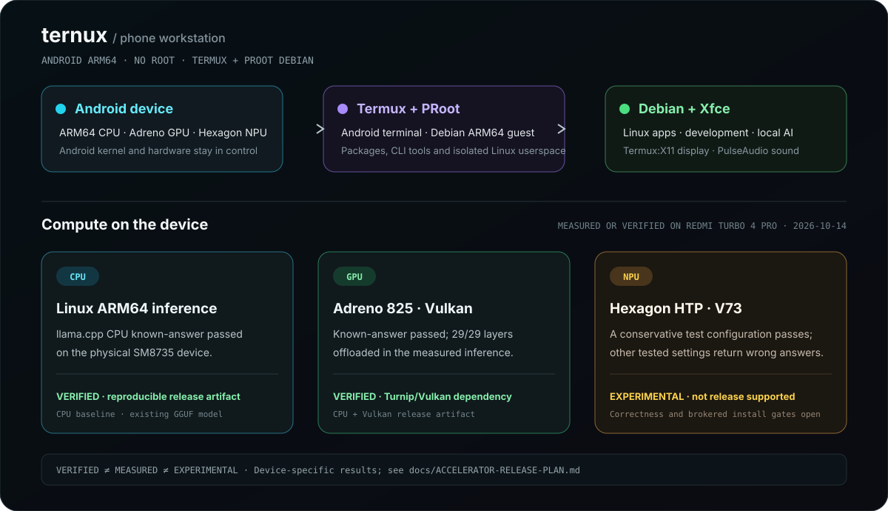

<div align="center">

<!-- deterministic-state-bridge: ternux -->

**Machine-generated operational state:** see [`.repo/STATUS.md`](.repo/STATUS.md) (generated by `tools/repo_knowledge`). For cross-project SKB registry state, see [`ternux.json`](https://github.com/soobujmiah/skb/blob/main/projects/registry/ternux.json) in the parent SKB repository (`soobujmiah/skb`).

# ternux

### Debian + Xfce desktop on an ARM64 Android phone — no root required

[](https://github.com/soobujmiah/ternux/releases)
[](https://github.com/soobujmiah/ternux)
[-f59e0b?style=flat-square)](docs/ACCELERATOR-RELEASE-PLAN.md)
[](LICENSE)

[Website](https://soobujmiah.github.io/ternux/) · [Deep documentation](docs/README.md) · [বাংলা](bn/README.md) · [Source](https://github.com/soobujmiah/ternux)

</div>

Ternux sets up Debian and Xfce4 in Termux using PRoot. Termux:X11 displays the
desktop and PulseAudio connects sound. Graphics use Zink/Turnip on supported
Adreno devices or VirGL as a compatibility route. Results vary by device.

Ternux is designed as a lightweight, managed Linux workstation for Android:
install once, start the desktop in the background, and use the `ternux` CLI to
inspect or repair it. It does not need root, replace Android, or promise the
same graphics performance on every phone.



## Install

1. Install [Termux](https://github.com/termux/termux-app/releases) and
   [Termux:X11](https://github.com/termux/termux-x11/releases) from compatible
   sources. Open Termux:X11 once. Optional companion apps:
   [Termux:Boot](https://github.com/termux/termux-boot/releases) starts configured
   scripts after reboot, [Termux:API](https://github.com/termux/termux-api/releases)
   enables Android integrations such as microphone access, and
   [Termux:Styling](https://github.com/termux/termux-styling/releases) adds
   terminal themes and fonts. Install Termux and its add-ons from the same source.
2. In Termux, run:

```bash
curl -fsSL https://raw.githubusercontent.com/soobujmiah/ternux/main/install.sh | bash
```

If `curl` is unavailable, use:

```bash
wget -qO- https://raw.githubusercontent.com/soobujmiah/ternux/main/install.sh | bash
```

The base install needs about 4–4.5 GB of storage. Keep extra temporary space for
downloads and package caches.

## Start and use

In Termux, start the desktop:

```bash
source ~/.bashrc
x
```

Switch to the Termux:X11 app to see Xfce. Common commands, all run in Termux:

```bash
ternux status     # show session and install state
ternux verify     # check the installation and graphics route
ternux doctor     # diagnose common problems
ternux stop       # stop the desktop session
```

The `x` shortcut starts the desktop; `xgo` opens Termux:X11 and starts it.
Inside Debian, use `db` from Termux to open a shell. Shared Android storage is
available at `/sdcard` inside Debian.

## What you get

**Base desktop:** Debian 13 (Trixie) in a user-space PRoot container, Xfce4,
Termux:X11 display integration, and PulseAudio audio routing. The default setup
includes Bangla-capable Noto fonts, Avro phonetic input (Ctrl+Space), VLC,
PulseAudio Volume Control, Xfce Task Manager and Mousepad. A one-time first-run
welcome opens the project website in Firefox ESR when installed; without a
browser it shows an in-desktop welcome guide. Firefox is optional.

**Graphics:** automatic Zink + Turnip setup for supported Adreno/KGSL devices,
with VirGL as a compatibility route. Use `ternux verify` and
`glxinfo -B` inside Debian to inspect the active renderer; a desktop opening
does not by itself prove hardware acceleration. `ternux gpu` and
`ternux backend` inspect and manage the driver route. See
[graphics persistence](docs/GRAPHICS-PERSISTENCE.md).

**Optional software:** the interactive installer lets you choose individual
packages or workload groups. Choices include developer toolchains and editors,
Android SDK/NDK tools, Firefox and Thunderbird, local AI runtimes, network
utilities, media and graphics apps, office tools, and Blender. The base install
stays smaller; choose only what you need. The `--all` profile needs roughly
10.5–12.5 GB installed and about 14 GB free during setup. See
[workload details](docs/WORKLOADS.md).

**Local AI and GPU tools:** the optional llama.cpp CPU + Vulkan extension is
installed separately with `ternux extension install llama-vulkan`. A separate
Hexagon HTP extension is explicitly experimental and device-specific; neither
extension includes model files. Blender and headless EEVEE tools are optional.
The [release plan](docs/ACCELERATOR-RELEASE-PLAN.md) records current support
limits and qualification gates.

## Manage and troubleshoot

The CLI can start, stop and restart a managed background desktop; report
session, device and install state; run diagnostics and safe repair; verify the
installation; inspect or update the graphics backend; capture GPU benchmarks
and device profiles; view logs; update Ternux; manage extensions; and remove
selected components. Commands support help, and documented commands also offer
machine-readable JSON.

```bash
ternux info             # device and system summary
ternux logs desktop tail # recent desktop log
ternux gpu status        # graphics driver status
ternux --help            # command list
```

See the [CLI reference](docs/CLI.md), [daily use](docs/USAGE.md), and
[troubleshooting guide](docs/TROUBLESHOOTING.md) for exact behavior. Android
memory pressure and vendor battery policies can still stop long-running PRoot
sessions; Ternux reports diagnostics but cannot override every device policy.

For Android app development on this same device, install ADT inside the Ternux
Debian guest. The build-to-device workflow is validated on the shared Termux +
PRoot host; use from inside the Ternux Xfce session is not formally tested yet.
See the [ADT setup steps](docs/INSTALLATION.md#install-adt-tools-inside-the-ternux-debian-guest)
and [ADT + Ternux notes](https://github.com/soobujmiah/adt/blob/main/docs/TERNUX_RELATIONSHIP.md).

For Blender work, coding agents can use Ternux's local GPU MCP to check the
render route and run scripts or scenes with the documented EEVEE setup. See the
[MCP guide](tools/blender-gpu-mcp/README.md) and [render evidence](experiments/cartoon-pipeline/README.md).

## More help

- [Deep documentation index](docs/README.md): install paths, setup, daily use,
  configuration, workloads, troubleshooting, architecture and CLI.
- [Quick start](docs/QUICK-START.md): first install, launch and renderer check.
- [Benchmarks](docs/BENCHMARKS.md): measured device results and their limits.
- [Changelog](CHANGELOG.md)

With a terminal attached, the installer offers a numbered optional
software chooser; Enter keeps the base desktop. `--yes` skips prompts and
installs the base profile, while explicit `--with-*` flags or `--all` select
additional workloads. The `pkg install ternux` package route is prepared for
the v2 release but is not published yet; use the installer above for now. See
the [Termux APT guide](docs/TERMUX-APT.md). Review the linked guides for
requirements and exact commands. The published release and experimental CPU/GPU/NPU gates are tracked
in [`docs/ACCELERATOR-RELEASE-PLAN.md`](docs/ACCELERATOR-RELEASE-PLAN.md).
