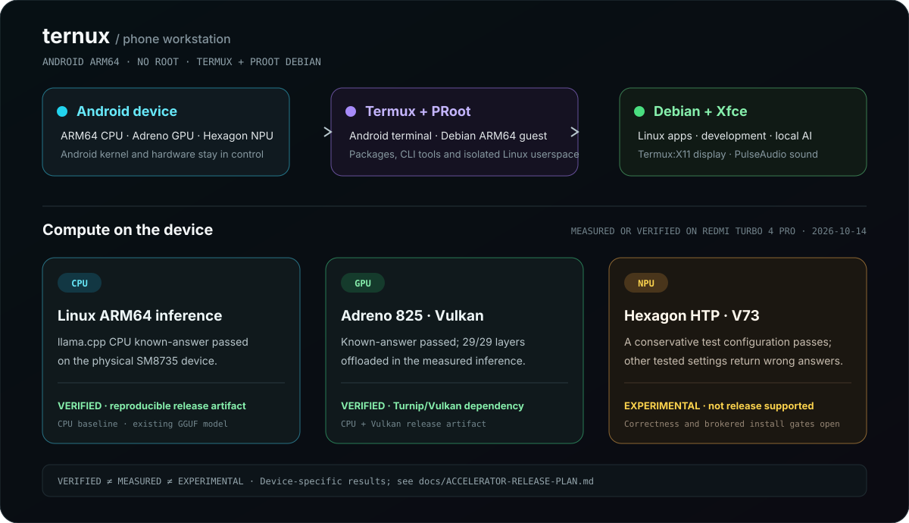

<div align="center">

<!-- deterministic-state-bridge: ternux -->

**Machine-generated operational state:** see [`.repo/STATUS.md`](.repo/STATUS.md) (generated by `tools/repo_knowledge`). For cross-project SKB registry state, see [`ternux.json`](https://github.com/soobujmiah/skb/blob/main/projects/registry/ternux.json) in the parent SKB repository (`soobujmiah/skb`).

# ternux

### Debian + Xfce desktop on an ARM64 Android phone — no root required

[](https://github.com/soobujmiah/ternux/releases)
[](https://github.com/soobujmiah/ternux)
[-f59e0b?style=flat-square)](docs/ACCELERATOR-RELEASE-PLAN.md)
[](LICENSE-SCOPE.md)

[Website](https://soobujmiah.github.io/ternux/) · [Deep documentation](docs/README.md) · [বাংলা](bn/README.md) · [Source](https://github.com/soobujmiah/ternux)

</div>

Ternux sets up Debian and Xfce4 in Termux using PRoot. Termux:X11 displays the
desktop and PulseAudio connects sound. Graphics use Zink/Turnip on supported
Adreno devices or VirGL as a compatibility route. Results vary by device.



## Install

1. Install [Termux](https://github.com/termux/termux-app/releases) and
   [Termux:X11](https://github.com/termux/termux-x11/releases) from compatible
   sources. Open Termux:X11 once.
2. In Termux, run:

```bash
curl -fsSL https://soobujmiah.github.io/ternux/install.sh | bash
```

If `curl` is unavailable, use:

```bash
wget -qO- https://soobujmiah.github.io/ternux/install.sh | bash
```

The base install needs about 3–4 GB of storage. Keep extra temporary space for
downloads and package caches.

## Start and use

In Termux, start the desktop:

```bash
source ~/.bashrc
x
```

Switch to the Termux:X11 app to see Xfce. Common commands, all run in Termux:

```bash
ternux status     # show session and install state
ternux verify     # check the installation and graphics route
ternux doctor     # diagnose common problems
ternux stop       # stop the desktop session
```

The `x` shortcut starts the desktop; `xgo` opens Termux:X11 and starts it.
Inside Debian, use `db` from Termux to open a shell. Shared Android storage is
available at `/sdcard` inside Debian.

For Android app development on this same device, install ADT inside the Ternux
Debian guest. The build-to-device workflow is validated on the shared Termux +
PRoot host; use from inside the Ternux Xfce session is not formally tested yet.
See the [ADT setup steps](docs/INSTALLATION.md#install-adt-tools-inside-the-ternux-debian-guest)
and [ADT + Ternux notes](https://github.com/soobujmiah/adt/blob/main/docs/TERNUX_RELATIONSHIP.md).

For Blender work, coding agents can use Ternux's local GPU MCP to check the
render route and run scripts or scenes with the measured EEVEE setup. See the
[MCP guide](tools/blender-gpu-mcp/README.md) and [render evidence](experiments/cartoon-pipeline/README.md).

## More help

- [Deep documentation index](docs/README.md): installation options, manual
  setup, daily use, configuration, troubleshooting, architecture and CLI.
- [Quick start](docs/QUICK-START.md): first install, launch and renderer check.
- [Benchmarks](docs/BENCHMARKS.md): measured device results and their limits.
- [Changelog](CHANGELOG.md)

With a terminal attached, the one-command installer suggests optional workloads and lets you choose by number; Enter keeps the base desktop, while `--yes` skips prompts and installs the base profile. The website provides the same short install and usage path, explains the numbered
choices and summarizes practical device workloads; deeper technical procedures
remain in the repository guides. Current experimental CPU/GPU/NPU release gates
are tracked in [`docs/ACCELERATOR-RELEASE-PLAN.md`](docs/ACCELERATOR-RELEASE-PLAN.md).
