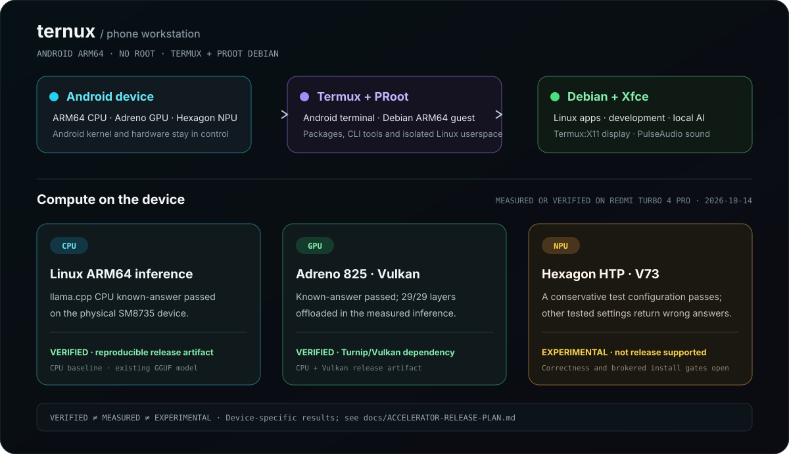

<div align="center">

<!-- deterministic-state-bridge: ternux -->

**স্বয়ংক্রিয় repository status:** [`.repo/STATUS.md`](../.repo/STATUS.md)। SKB registry: [`ternux.json`](https://github.com/soobujmiah/skb/blob/main/projects/registry/ternux.json)।

# ternux

### ARM64 Android ফোনে Linux desktop — root লাগে না

[](https://github.com/soobujmiah/ternux/releases/tag/v2.0.0)
[](../docs/TERMUX-APT.md)
[](../docs/audit/FEATURE-MATRIX.md)
[](../docs/v3/README.md)
[](../docs/INSTALLATION.md)
[](../docs/FAQ.md)
[](../docs/audit/FEATURE-MATRIX.md)
[](../docs/BENCHMARKS.md)
[](../docs/INSTALLATION.md#choosing-a-guest-distribution)
[](../docs/QUICK-START.md)
[](../docs/USAGE.md#android-microphone-input)
[](../docs/QUICK-START.md#first-gui-run-browser-and-video)
[](../docs/WORKLOADS.md#the-workloads)
[](../docs/ACCELERATOR-RELEASE-PLAN.md)
[](../LICENSE)

[ওয়েবসাইট](https://soobujmiah.github.io/ternux/) · [দ্রুত শুরু](../docs/QUICK-START.md) · [সব ডকুমেন্টেশন](../docs/README.md) · [CLI নির্দেশিকা](../docs/CLI.md) · [Benchmark](../docs/BENCHMARKS.md) · [v2 release ও বর্তমান audit](../docs/release/V2-RELEASE-REPORT.md) · [English](../README.md) · [Source](https://github.com/soobujmiah/ternux)

</div>

## Ternux সম্পর্কে

Ternux ARM64 Android ফোনে root ছাড়াই Linux desktop চালায়; Android-ই host
থাকে। Termux-এর মধ্যে PRoot guest চলে, Termux:X11-এ Xfce desktop দেখা যায়,
আর PulseAudio guest-এর sound Android-এ route করে। একটি CLI দিয়ে guest,
desktop session, graphics, diagnostics ও optional workload পরিচালনা করা যায়।

দৈনন্দিন browsing, document, media, photo ও audio recording-এর app-সহ Ternux-এর
নিজস্ব theme এবং phone-sized window ব্যবস্থা থাকে। Developer tools ও local
CPU/Vulkan AI workload দরকার হলে optional হিসেবে install করা যায়। Termux-কে
storage permission দিলে guest থেকে Android shared storage-এর file ও model
সরাসরি ব্যবহার করা যায়।

**v2-তে Debian, Ubuntu ও Alpine—এই তিনটি desktop profile supported।** Device
evidence Redmi Turbo 4 Pro / Android 16 / Adreno 825-এর; ঠিক কোন পরীক্ষা হয়েছে
তা feature matrix ও current audit-এ দেখুন।
Debian recommended default। আরও ১২টি named distro recipe চেষ্টা করা যায়, তবে
v2 desktop support হিসেবে সেগুলো qualified নয়। Ternux desktop recipe না থাকলে
arbitrary OCI image shell guest হিসেবে চলে।

### Graphics ও guest support

১৫টি named recipe-তেই distro-specific Mesa GL package আছে। Adreno/KGSL-এ distro সমর্থন করলে Zink/Freedreno-কে
অগ্রাধিকার দেয়; Debian Trixie-তে validated Turnip payload-ও আছে। VirGL হলো
compatibility route। কোন renderer চলছে তা guest-এর `glxinfo -B` দিয়ে দেখুন।

### কোথা থেকে শুরু করবেন

- **প্রথমবার?** [দ্রুত শুরু করুন](../docs/QUICK-START.md)।
- **Guest support বুঝতে?** [v2 support matrix](../docs/audit/FEATURE-MATRIX.md)।
- **মাপজোখ দেখতে?** [Benchmark ও সীমাবদ্ধতা](../docs/BENCHMARKS.md)।
- **Command খুঁজছেন?** [CLI reference](../docs/CLI.md)।



## ইনস্টল

১. [F-Droid থেকে Termux](https://f-droid.org/packages/com.termux/) অথবা
[GitHub release](https://github.com/termux/termux-app/releases) নিন, সঙ্গে
[Termux:X11](https://github.com/termux/termux-x11/releases) ইনস্টল করুন।
একাধিক GUI আলাদা Android window-তে দেখাতে nightly build নিন। Termux সামনে
বা পেছনে থাকলে Android যেন Linux workload কম throttle করে, সে জন্য GitHub-এর
Termux ব্যবহারকারীরা upstream
[shared-UID debug APK](https://github.com/termux/termux-x11/releases/tag/nightly)
(`termux-x11-universal-sharedUid-debug.apk`) নিতে পারেন; এটি Termux-এর
shared Android UID-তে চলে। এটি শুধু GitHub-signed Termux-এর সঙ্গে কাজ করে।
F-Droid বা Google Play Termux হলে একই release page-এর সাধারণ
[`termux-x11-universal-debug.apk`](https://github.com/termux/termux-x11/releases/tag/nightly)
ব্যবহার করুন। Termux:X11 একবার খুলুন। অতিরিক্ত companion app হিসেবে
[Termux:Boot-এর F-Droid](https://f-droid.org/packages/com.termux.boot/) অথবা
[GitHub](https://github.com/termux/termux-boot/releases) version reboot-এর পর
নির্ধারিত script চালায়; [Termux:API-এর F-Droid](https://f-droid.org/packages/com.termux.api/)
অথবা [GitHub](https://github.com/termux/termux-api/releases) Android utility দেয়
(সঙ্গে Termux-এ `pkg install termux-api` চালাতে হবে); আর
[Termux:Styling-এর F-Droid](https://f-droid.org/packages/com.termux.styling/)
অথবা [GitHub](https://github.com/termux/termux-styling/releases) terminal theme
ও font যোগ করে। Desktop app-এর live mic on-demand Termux OpenSL ES
source দিয়ে চলে; API recorder file তৈরি করে। Termux ও add-on একই source থেকে নিন।
২. Termux-এ চালান:

```bash
pkg update -y && pkg install -y curl && curl -fsSL https://raw.githubusercontent.com/soobujmiah/ternux/main/install.sh | bash
```

`curl` না থাকলে চালান:

```bash
pkg update -y && pkg install -y wget && wget -qO- https://raw.githubusercontent.com/soobujmiah/ternux/main/install.sh | bash
```

Termux-এর নিজস্ব package manager দিয়ে install করতে signed stable APT source
একবার bootstrap করুন। Script key যাচাই করে host CLI install করবে; এরপর guest
desktop setup করতে `tx install` চালান। Update ও আলাদা RC channel-এর জন্য
[APT installation guide](docs/TERMUX-APT.md) দেখুন।

```bash
pkg install curl gnupg
curl -fsSLo "$TMPDIR/ternux-bootstrap.sh" \
  https://soobujmiah.github.io/ternux/apt/bootstrap.sh
bash "$TMPDIR/ternux-bootstrap.sh"
```

বেস ইনস্টলে প্রায় ৪–৪.৫ GB storage লাগে। Download ও package cache-এর জন্য আরও
কিছু খালি জায়গা রাখুন।

## চালান ও ব্যবহার

Termux-এ desktop চালু করুন:

```bash
source ~/.bashrc
x
```

Xfce দেখতে Termux:X11 app-এ যান। সাধারণ command-গুলো Termux-এ চালান:

```bash
ternux status     # session ও install-এর অবস্থা
ternux verify     # active guest যাচাই; db/ub/alp দিয়ে guest বেছে নিন
ternux doctor     # সাধারণ সমস্যা খোঁজা
tx stop           # চলমান guest desktop বাছাই করে বন্ধ
```

`x` saved desktop চালায়; একাধিক installed profile থাকলে `xgo` তালিকা দেখায়। আলাদা desktop guest নিজস্ব tagged Termux:X11 window-তে চলতে পারে। একাধিক profile একবারে install করতে `tx install --distros debian,ubuntu,alpine` ব্যবহার করুন। `tx stop` এক বা একাধিক session বাছতে দেয়; `tx stop --all` সব বন্ধ করে। Debian shell-এর জন্য
Termux-এ `db` চালান। Android storage permission থাকলে shared storage managed guest-এ `/sdcard` হিসেবে default-এ mount হয়। path না থাকলে `termux-setup-storage` চালিয়ে desktop restart করুন।

## কী কী পাবেন

**বেস desktop:** user-space PRoot container-এ Debian 13 (Trixie), Xfce4,
Termux:X11 display integration এবং PulseAudio audio routing। বেস setup-এ
Bangla-capable Noto font ও Debian/Ubuntu-তে Avro phonetic input (Ctrl+Space) থাকে। Alpine-এ একই Avro phonetic input IBus m17n engine দিয়ে দেওয়া হয়। VLC, PulseAudio
Volume Control, Xfce Task Manager, Mousepad, Galculator, Evince PDF reader,
Ternux Camera, Ternux Sound Recorder, Ristretto image viewer এবং নিজস্ব
Ternux theme/icon-সহ Synaptic Package Manager থাকে। Synaptic দিয়ে Debian
package খুঁজে install, upgrade ও remove করা যায়। Evince default PDF reader;
PDF page edit ও অন্য format-এ export করতে optional LibreOffice Draw নিন।
Celestia optional astronomy app। Fresh install-এ mail client install বা default
করা হয় না; Evolution Mail optional, common provider-এ OAuth এবং অন্য server-এ
manual IMAP/POP সমর্থন করে। OAuth-এর জন্য base desktop-এ থাকা Firefox ESR ব্যবহার হয়; সেটি চালু না হলে Ternux bridge Android-এর default browser খোলে।

Graphite-and-emerald GTK theme, custom window border/titlebar এবং ১৫টি আলাদা
portrait-first wallpaper desktop branding-এর অংশ; landscape-এ wallpaper-এর
অনুপাত ঠিক থাকে। App, folder, Thunar action, category ও panel-এর original
Ternux icon আছে; Firefox ESR, Blender, GIMP, Krita, Inkscape, Audacity, Geany,
Evolution Mail ও LibreOffice-এর মতো optional app-ও branded icon পায়। পরে যোগ
করা uncommon app-এ neutral Adwaita fallback থাকে। Papirus theme inherit করে না।

Xfce panel-এ Camera, Photos ও Sound Recorder-এর one-click shortcut থাকে।
Ternux Camera Android front/rear camera দেখায়; Termux:API app ও matching
`termux-api` package লাগবে। প্রথম capture-এ Android Camera permission চায়।
তোলা ছবি EXIF orientation ঠিক রেখে app-এ preview হয় এবং active guest-এর
`~/Pictures/Ternux`-এ save হয়; Android Gallery-তে পাঠানো হয় না। এটি still-photo
capture; live camera stream এখনো দেয় না। প্রথম GUI চালু হলে project website
একবার খোলে; fresh install-এ Firefox ESR default-এ থাকে। Ubuntu-তে Mozilla-র official ESR build বসে, কারণ Ubuntu archive-এর Firefox Snap চায় এবং Ternux PRoot-এ Snap বন্ধ রাখে। Sound Recorder-এ
Start চাপলেই microphone চালু হয়; AAC/M4A default, MP3-ও বেছে নেওয়া যায়
(guest-এর FFmpeg দিয়ে encode হয়)। Recording active guest-এর
`~/Music/Ternux`-এ থাকে।
**Graphics:** প্রতিটি named desktop profile-এ distro-র Mesa GL driver ও GPU
route ইনস্টল হয়। Adreno/KGSL থাকলে auto প্রতিটি distro-র Mesa/Freedreno
package থেকে Zink বেছে নেয়; Debian Trixie-তে পরীক্ষিত direct Zink + Turnip
চলে, VirGL compatibility route। Hardware acceleration guest package, device ও
Android build-এর উপর নির্ভর করে। `ternux verify` এবং guest-এর `glxinfo -B` দিয়ে renderer দেখুন;
desktop খুললেই hardware acceleration প্রমাণ হয় না। `ternux gpu` ও
`ternux backend` route দেখায় ও পরিচালনা করে। বিস্তারিত
[graphics persistence](../docs/GRAPHICS-PERSISTENCE.md)।

**ঐচ্ছিক software:** installer-এর numbered তালিকা থেকে package বা workload বেছে নিতে
পারবেন। Developer toolchain ও editor, Android SDK/NDK ও Firefox,
local AI runtime, network utility, media/graphics app, office tool এবং Blender
পছন্দ করা যায়। শুধু দরকারি জিনিস নিলে base install ছোট থাকে। `--all` profile
install-এর পর প্রায় ১০.৫–১২.৫ GB নেয় এবং setup চলাকালে প্রায় ১৪ GB খালি জায়গা
লক্ষ্য রাখে। [Workload guide](../docs/WORKLOADS.md) দেখুন।

**Local AI ও GPU tool:** ঐচ্ছিক llama.cpp CPU + Vulkan extension আলাদা করে
`ternux extension install llama-vulkan` দিয়ে install হয়। Hexagon HTP extension
আলাদা, device-specific এবং experimental; কোনো extension-এ model file থাকে না।
Blender ও headless EEVEE tool-ও optional। Model setup ও কম RAM-এ context
সীমিত রাখার জন্য [llama.cpp extension guide](../guides/llama-vulkan-extension.md),
আর support/qualification সীমার জন্য [release plan](../docs/ACCELERATOR-RELEASE-PLAN.md) দেখুন।

## পরিচালনা ও সমস্যা সমাধান

CLI দিয়ে managed background desktop start/stop/restart, session/device/install
state দেখা, diagnostics ও safe repair, installation verify, graphics backend
দেখা বা update, GPU benchmark ও device profile নেওয়া, log দেখা, Ternux update,
extension manage এবং নির্বাচিত component uninstall করতে পারবেন। Command-গুলোর
help আছে; নির্দিষ্ট command-গুলো machine-readable JSON-ও দেয়।

```bash
ternux info             # device ও system summary
ternux logs desktop tail # desktop log-এর শেষ অংশ
ternux gpu status        # graphics driver-এর অবস্থা
ternux --help            # command list
```

বিস্তারিত behavior-এর জন্য [CLI reference](../docs/CLI.md), [দৈনন্দিন ব্যবহার](../docs/USAGE.md)
এবং [সমস্যা সমাধান](../docs/TROUBLESHOOTING.md) দেখুন। Android memory pressure
বা vendor battery policy দীর্ঘ PRoot session বন্ধ করে দিতে পারে; সব device policy
Ternux নিয়ন্ত্রণ করতে পারে না।

## একই device-এ Android development

Ternux Debian guest-এর ভেতরে ADT install করে Android app build, sign ও device-এ
validate করতে পারবেন। Shared Termux + PRoot host-এ ADT build-to-device workflow
verified; Ternux Xfce session থেকে চালানো এখনো formally tested নয়।
[ADT installation steps](docs/INSTALLATION.md)
এবং [ADT + Ternux relationship](https://github.com/soobujmiah/adt/blob/main/docs/TERNUX_RELATIONSHIP.md) দেখুন।

Blender render-এর জন্য coding agent-কে local GPU MCP দিয়ে route পরীক্ষা ও
script/scene render করানো যায়। [MCP guide](../tools/blender-gpu-mcp/README.md)
এবং [render evidence](../experiments/cartoon-pipeline/README.md) দেখুন।

## আরও সহায়তা

- [বিস্তারিত ডকুমেন্টেশন](../docs/README.md): install option, হাতে setup,
  দৈনন্দিন ব্যবহার, configuration, troubleshooting, architecture ও CLI।
- [v3 architecture ও roadmap](../docs/v3/README.md): manager, workspace,
  compute, AI, Device Bridge, security ও gate। Current `main` source-এ তিনটি
  read-only manager CLI command আছে, কিন্তু stable v2.0.0 package-এ নেই; socket
  service ও Control Center এখনো তৈরি হয়নি।
- [দ্রুত শুরু](../docs/QUICK-START.md): প্রথম install, launch ও renderer check।
- [Benchmark](../docs/BENCHMARKS.md): মাপা device ফলাফল ও তার সীমা।
- [পরিবর্তনলগ](../CHANGELOG.md)

Interactive install-এ প্রথম checklist থেকে Space/number দিয়ে এক বা একাধিক guest
profile বেছে Enter চাপুন; পরের category-ভিত্তিক checklist-এ optional software
বাছুন; Space বা item-এর
নম্বর দিয়ে একাধিক নির্বাচন toggle করুন, Enter-এ plan review করুন, `q` দিলে
শুধু base desktop থাকে। `--yes` prompt বাদ দিয়ে Debian base profile install করে।
Ternux v2.0.0 প্রকাশিত এবং signed stable APT repository চালু আছে। উপরের
command দিয়ে একবার bootstrap করুন; পরের install ও update সাধারণ `pkg` command-এ
হবে। GitHub release-এ `.deb` package ও checksum manifest-ও আছে। Current
`main` source-এর চারটি read-only `tx manager` command v2.0.0 package-এ নেই;
foreground Unix-socket service আছে, তবে background supervisor ও graphical
Control Center এখনো implemented নয়। Channel-এর
বিস্তারিত [Termux APT guide](../docs/TERMUX-APT.md), আর publication evidence
[v2 release ও বর্তমান audit](../docs/release/V2-RELEASE-REPORT.md)-এ দেখুন। HTP/HMX, QNN এবং
বিস্তৃত accelerator qualification experimental বা follow-up কাজ; [accelerator
plan](../docs/ACCELERATOR-RELEASE-PLAN.md)-এ বর্তমান সীমা আছে।
