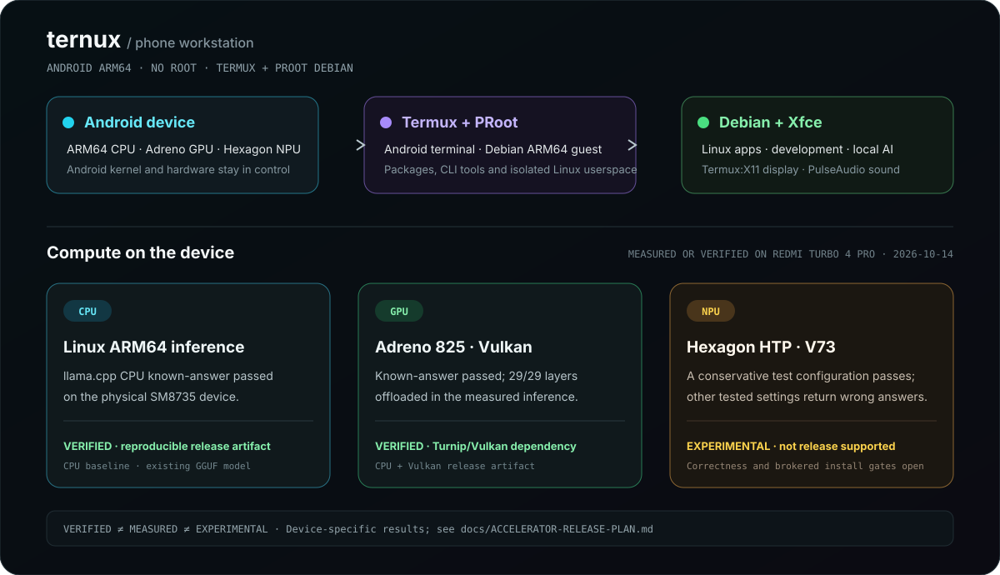

<div align="center">

<!-- deterministic-state-bridge: ternux -->

**স্বয়ংক্রিয় সংগ্রহশালা-অবস্থা:** [`.repo/STATUS.md`](../.repo/STATUS.md)—`tools/repo_knowledge` দিয়ে তৈরি।

# ternux

### এআরএম৬৪ অ্যান্ড্রয়েড ফোনে লিনাক্স ডেস্কটপ — রুট লাগে না

[](../docs/INSTALLATION.md#choosing-a-guest-distribution)
[](../docs/INSTALLATION.md)
[](../docs/FAQ.md)
[](../docs/BENCHMARKS.md)
[](../docs/INSTALLATION.md#choosing-a-guest-distribution)
[](../docs/QUICK-START.md)
[](../docs/USAGE.md#android-microphone-input)
[](../docs/QUICK-START.md#first-gui-run-browser-and-video)
[](../docs/WORKLOADS.md#the-workloads)
[](../docs/ACCELERATOR-RELEASE-PLAN.md)
[](../LICENSE)

[ওয়েবসাইট](https://soobujmiah.github.io/ternux/) · [উৎপত্তির গল্প](docs/ORIGIN.md) · [English Origin Story](../docs/ORIGIN.md) · [দ্রুত শুরু](../docs/QUICK-START.md) · [সব নথি](../docs/README.md) · [কমান্ড-লাইন নির্দেশিকা](../docs/CLI.md) · [পরীক্ষার মাপজোখ](../docs/BENCHMARKS.md) · [ইংরেজি](../README.md) · [উৎস](https://github.com/soobujmiah/ternux)

</div>

## Ternux সম্পর্কে

টার্নাক্স এআরএম৬৪ অ্যান্ড্রয়েড ফোনে রুট ছাড়াই লিনাক্স ডেস্কটপ চালায়; অ্যান্ড্রয়েডই
হোস্ট থাকে। উৎস-ইনস্টলার নির্দিষ্ট source snapshot ব্যবহার করে। Termux-এর ভেতরে
PRoot guest চলে, Termux:X11-এ Xfce desktop দেখা যায় এবং PulseAudio গেস্টের শব্দ
অ্যান্ড্রয়েডে পাঠায়। একটি command-line tool দিয়ে guest, desktop session,
graphics, diagnostics ও ঐচ্ছিক workload পরিচালনা করা যায়।

দৈনন্দিন ওয়েব দেখা, নথি সম্পাদনা, গান-ভিডিও চালানো, ছবি তোলা ও শব্দ ধারণের
অ্যাপসহ টার্নাক্সে নিজস্ব রং-নকশা এবং ফোনের মাপের জানালা থাকে। নির্মাণ-সরঞ্জাম
ও প্রসেসর/ভলকান-চালিত স্থানীয় কৃত্রিম বুদ্ধিমত্তার কাজ চাইলে আলাদাভাবে বসানো
যায়। টার্মাক্সকে সংরক্ষণ-অনুমতি দিলে গেস্ট থেকে অ্যান্ড্রয়েডের ভাগ করা ফাইল
ও মডেল সরাসরি ব্যবহার করা যায়।

**বর্তমানে আমরা Debian, Ubuntu, Kali Linux এবং Alpine-এর চারটি desktop setup রক্ষণাবেক্ষণ করি।**
যন্ত্রের অধিকাংশ পরীক্ষা Redmi Turbo 4 Pro / Android 16 / Adreno 825-এ হয়েছে;
প্রতিটি distro ও feature-এর প্রমাণের গভীরতা আলাদা। নির্দিষ্ট পরীক্ষার সীমা
[সুবিধা-তালিকায়](../docs/audit/FEATURE-MATRIX.md) দেখুন। Debian প্রস্তাবিত
প্রাথমিক পছন্দ। আরও ১১টি নামযুক্ত distro recipe চেষ্টা করা যায়, তবে একই
পরীক্ষার প্রমাণ নেই। Ternux desktop recipe নেই এমন OCI image কেবল shell guest।

### গ্রাফিক্স ও গেস্ট সমর্থন

১৫টি নামযুক্ত রেসিপিতেই ডিস্ট্রো-নির্দিষ্ট মেসা জিএল প্যাকেজ আছে। অ্যাড্রেনো/
কেজিএসএল থাকলে এবং ডিস্ট্রো সমর্থন করলে জিঙ্ক/ফ্রিড্রিনো অগ্রাধিকার পায়;
ডেবিয়ান ট্রিক্সিতে যাচাইকৃত টার্নিপ প্যাকেজও আছে। ভিরজিএল সামঞ্জস্য-পথ।
গেস্টের `glxinfo -B` দিয়ে চলমান রেন্ডারার দেখুন।

### কোথা থেকে শুরু করবেন

- **প্রথমবার?** [দ্রুত শুরু করুন](../docs/QUICK-START.md)।
- **গেস্ট setup-এর পরীক্ষা জানতে?** [সুবিধা-তালিকা](../docs/audit/FEATURE-MATRIX.md)।
- **মাপজোখ দেখতে?** [পরীক্ষার ফল ও সীমাবদ্ধতা](../docs/BENCHMARKS.md)।
- **কমান্ড খুঁজছেন?** [কমান্ড-লাইন নির্দেশিকা](../docs/CLI.md)।



## ইনস্টলেশন

১. [এফ-ড্রয়েড থেকে টার্মাক্স](https://f-droid.org/packages/com.termux/) অথবা
[গিটহাবের প্রকাশনা](https://github.com/termux/termux-app/releases) নিন, সঙ্গে
[টার্মাক্স:এক্স১১](https://github.com/termux/termux-x11/releases) বসান।
একাধিক গ্রাফিক্যাল ডেস্কটপ আলাদা অ্যান্ড্রয়েড জানালায় দেখতে পরীক্ষামূলক
নাইটলি সংস্করণ নিন। টার্মাক্স সামনে বা পেছনে থাকলে অ্যান্ড্রয়েড যেন লিনাক্সের
কাজ কম ধীর করে, সে জন্য গিটহাব সংস্করণের টার্মাক্স ব্যবহারকারীরা নির্মাতার
[shared-UID debug APK](https://github.com/termux/termux-x11/releases/tag/nightly)
(`termux-x11-universal-sharedUid-debug.apk`) নিতে পারেন; এটি টার্মাক্সের
অ্যান্ড্রয়েড পরিচয় ভাগ করে চলে এবং শুধু গিটহাব-স্বাক্ষরিত টার্মাক্সের সঙ্গেই
কাজ করে। এফ-ড্রয়েড বা গুগল প্লে টার্মাক্স হলে একই প্রকাশনা-পাতার সাধারণ
[`termux-x11-universal-debug.apk`](https://github.com/termux/termux-x11/releases/tag/nightly)
ব্যবহার করুন। টার্মাক্স:এক্স১১ একবার খুলুন। অতিরিক্ত সহচর অ্যাপ হিসেবে
[টার্মাক্স:বুটের এফ-ড্রয়েড সংস্করণ](https://f-droid.org/packages/com.termux.boot/) অথবা
[গিটহাব সংস্করণ](https://github.com/termux/termux-boot/releases) যন্ত্র পুনরায়
চালুর পর নির্ধারিত কাজ চালায়; [টার্মাক্স:এপিআই-এর এফ-ড্রয়েড সংস্করণ](https://f-droid.org/packages/com.termux.api/)
অথবা [গিটহাব সংস্করণ](https://github.com/termux/termux-api/releases) অ্যান্ড্রয়েডের
সরঞ্জাম দেয় (টার্মাক্সে `pkg install termux-api`-ও চালাতে হবে); আর
[টার্মাক্স:স্টাইলিংয়ের এফ-ড্রয়েড সংস্করণ](https://f-droid.org/packages/com.termux.styling/)
অথবা [গিটহাব সংস্করণ](https://github.com/termux/termux-styling/releases)
টার্মিনালের রং-নকশা ও হরফ যোগ করে। ডেস্কটপ অ্যাপের সরাসরি মাইক্রোফোন-শব্দ
চাহিদামতো টার্মাক্সের ওপেনএসএল ইএস পথ দিয়ে আসে; এপিআই রেকর্ডার ফাইল তৈরি
করে। টার্মাক্স ও সহচর অ্যাপগুলো একই উৎস থেকে নিন। টার্মিনালের শর্টকাট ও বিশেষ
চিহ্ন টাইপ করার জন্য ঐচ্ছিক অ্যান্ড্রয়েড অন-স্ক্রিন কিবোর্ড
[Unexpected Keyboard-এর GitHub প্রকাশনা](https://github.com/Julow/Unexpected-Keyboard/releases)
অথবা [Google Play](https://play.google.com/store/apps/details?id=juloo.keyboard2) থেকে নিন।
২. সচল টার্মাক্সে নিচের কমান্ড চালিয়ে প্যাকেজ হালনাগাদ, দুইটি নামানোর
সরঞ্জাম ইনস্টল ও টার্নাক্স চালু করুন। `curl` চালু না হলে বা ফাইল নামাতে না
পারলে কমান্ডটি `wget` দিয়ে আবার চেষ্টা করে:

```bash
pkg update -y && pkg upgrade -y && pkg install -y curl wget && bash -c 's=$(mktemp) && (curl -fsSL https://raw.githubusercontent.com/soobujmiah/ternux/fc28dbff0c190e3991565556eb4ee6be09963401/install.sh -o "$s" || wget -qO "$s" https://raw.githubusercontent.com/soobujmiah/ternux/fc28dbff0c190e3991565556eb4ee6be09963401/install.sh) && bash "$s"; r=$?; rm -f "$s"; exit "$r"'
```

কোনো আবশ্যিক ধাপে ইনস্টলেশন থেমে গেলে একই কমান্ড আবার চালান। এতে বর্তমান
ইনস্টলার নামবে এবং ব্যর্থ ধাপ থেকে অসম্পূর্ণ গেস্টের কাজ নিজে থেকেই চলবে;
আগে গেস্টটি মুছবেন না।

নেটিভ টার্মাক্স প্যাকেজ হালনাগাদের আগে টার্নাক্স সচল আনুষ্ঠানিক টার্মাক্স
মিররগুলোর গতি মেপে দ্রুততমটি বেছে নেয়। ডেবিয়ান গেস্টেও মূল আর্কাইভের দ্রুততম
আনুষ্ঠানিক মিরর বেছে নেয়; নির্বাচিত মিরর ব্যর্থ হলে অন্য সচল আনুষ্ঠানিক মিররে
গিয়ে আবার চেষ্টা করে। ডেবিয়ানের নিরাপত্তা আপডেট আনুষ্ঠানিক নিরাপত্তা আর্কাইভ
থেকেই আসে। উবুন্টু, কালি, আল্পাইন ও অন্য গেস্টের নিজস্ব আনুষ্ঠানিক
রিডাইরেক্টর, সিডিএন বা মিরর তালিকা অক্ষত থাকে—তাই অন্য প্যাকেজ ব্যবস্থায়
ডেবিয়ানের মিরর বসে না। সমস্যা খুঁজতে ইনস্টল লগ টার্মাক্সের টার্নাক্স লগ
ডিরেক্টরিতে থাকে; সাময়িক অ্যাসেট স্টেজিং সফল বা ব্যর্থ—দুই অবস্থাতেই পরিষ্কার
হয়।

আংশিক হালনাগাদের পর `pkg` বা `curl` না চললে `apt update && apt full-upgrade -y`
চালিয়ে টার্মাক্স মেরামত করুন, তারপর আবার চেষ্টা করুন।
স্থিতিশীল প্যাকেজ ভান্ডার প্রত্যাহার হওয়ায় এখন উৎস ইনস্টলারই সমর্থিত বসানোর পথ।

Termux package repository বর্তমানে অপ্রাপ্য, তাই `pkg install ternux` ইনস্টলের
পথ নয়। উপরের pinned source installer ব্যবহার করুন। বিস্তারিত [package channel-এর
অবস্থা](../docs/TERMUX-APT.md)-তে দেখুন। [পরবর্তী সংস্করণের পরিকল্পনা](../docs/next/README.md)
ভবিষ্যতের ধারণা; প্রকাশিত সুবিধার দাবি নয়।

মূল ইনস্টলেশনে প্রায় ৪–৪.৬ জিবি জায়গা লাগে। ডাউনলোড ও প্যাকেজ ক্যাশের জন্য
আরও কিছু খালি জায়গা রাখুন।

## চালু ও ব্যবহার

টার্মাক্সে ডেস্কটপ চালু করুন:

```bash
source ~/.bashrc
tx start
```

এক্সএফসিই দেখতে টার্মাক্স:এক্স১১ অ্যাপে যান। নিচের কমান্ডগুলো টার্মাক্সে চলে:

```bash
tx status                  # সেশন ও ইনস্টলেশনের অবস্থা
tx verify                  # সক্রিয় গেস্ট যাচাই
tx verify db               # নির্দিষ্ট গেস্ট যাচাই
tx doctor                  # পরিচিত সমস্যা পরীক্ষা
tx stop                    # চলমান ডেস্কটপ বেছে বন্ধ
tx distro list             # ইনস্টল করা সব গেস্ট দেখুন
tx distro search alpine   # পিআররুট-ডিস্ট্রো ছবি খুঁজুন
tx distro uninstall NAME  # পরিচালিত গেস্ট সরান
```

`tx start` সংরক্ষিত ডেস্কটপ চালায়। একাধিক গেস্ট একসঙ্গে চালাতে
`tx start debian ubuntu kali alpine` লিখুন; সংক্ষিপ্ত নামও চলে, যেমন
`tx start ub db kali alp`। একাধিক প্রোফাইল বসাতে
`tx install --distros debian,ubuntu,kali,alpine` চালান। `tx stop` থেকে
এক বা একাধিক চলমান সেশন বেছে নিন; `tx stop --all` সব ডেস্কটপ বন্ধ করে।
গেস্টের সাধারণ শেল খুলতে `db`, `ub`, `kali` বা `alp` চালান; মূল ব্যবহারকারীর
শেলের জন্য যথাক্রমে `dbroot`, `ubroot`, `kaliroot` বা `alproot` চালান।
অ্যান্ড্রয়েডের সংরক্ষণ-অনুমতি থাকলে পরিচালিত গেস্টে `/sdcard` স্বয়ংক্রিয়ভাবে
যুক্ত হয়। পথটি না থাকলে `termux-setup-storage` চালিয়ে গেস্ট আবার শুরু করুন।

## কী কী পাবেন

**মূল ডেস্কটপ:** ডেবিয়ান ১৩ (ট্রিক্সি) প্রাথমিক পছন্দ; অন্য নামযুক্ত গেস্টে
সেই ডিস্ট্রোর উপযোগী রেসিপি চলে। ব্যবহারকারী-পরিসরের পিআররুট কন্টেইনারে
এক্সএফসিই ৪, টার্মাক্স:এক্স১১ পর্দা এবং পালসঅডিও শব্দ-সংযোগ থাকে। নটো বাংলা
ফন্ট ও লেখার পদ্ধতি দেওয়া হয়; ডেবিয়ান ও উবুন্টুতে আভ্রো ধ্বনিভিত্তিক
ইনপুট, আল্পাইনে আইবাস মটুন ইঞ্জিন থাকে। কন্ট্রোল+স্পেসে ইংরেজি ও বাংলা
বদলানো যায়। এক্স১১ জানালা-ব্যবস্থা বড় জানালাকে ব্যবহারযোগ্য পর্দায় আনে
এবং নতুন জানালা মাঝখানে রাখে। ভিএলসি, পালসঅডিও শব্দ-নিয়ন্ত্রণ, এক্সএফসিই
কাজের তালিকা, মাউসপ্যাড, গ্যালকুলেটর, এভিন্স পিডিএফ পাঠক, টার্নাক্স ক্যামেরা,
টার্নাক্স শব্দ-রেকর্ডার, রিস্ট্রেটো ছবি-দর্শক ও সিন্যাপটিক প্যাকেজ ব্যবস্থাপক
প্রতিটি পরিচালিত ডিস্ট্রোতে টার্নাক্স প্যাকেজ ব্যবস্থাপকের চালু করার ঘর থাকে।
APT গেস্টে টার্নাক্সের প্রতীক ও রঙে সাজানো সিন্যাপটিক খোলে; APK, pacman,
DNF, Zypper ও XBPS গেস্টে তাদের নিজস্ব প্যাকেজ ব্যবস্থাপক দিয়ে সংগ্রহস্থল
হালনাগাদ, প্যাকেজ খোঁজা, বসানো, সরানো এবং বসানো প্যাকেজের তালিকা দেখার
মেনু খোলে। অধিকাংশ ঐচ্ছিক কাজের জন্য APT গেস্ট লাগে; Alpine-এ বর্তমানে শুধু
Blender ঐচ্ছিকভাবে বসানো যায়। এভিন্স প্রাথমিক পিডিএফ পাঠক; লিব্রেঅফিস ড্র ঐচ্ছিক, পিডিএফ
পাতা সম্পাদনা ও অন্য ধরনে রপ্তানির জন্য। সেলেস্টিয়া ঐচ্ছিক জ্যোতির্বিজ্ঞান
অ্যাপ। ডাক-অ্যাপ প্রাথমিকভাবে বসে না; ইভল্যুশন মেইল ঐচ্ছিক, এতে ওঅথ অথবা
হাতে আইএমএপি/পিওপি সংযোগ ব্যবহার করা যায়।

গ্রাফাইট-সবুজ জিটিকে নকশা, জানালার সীমানা ও শিরোনাম-ফলক এবং ১৫টি
পটভূমিচিত্র ডেস্কটপের পরিচিতির অংশ; পর্দা আড়াআড়ি হলেও ছবির অনুপাত ঠিক
থাকে। অ্যাপ, ফোল্ডার, থুনারের কাজ, বিভাগ ও প্যানেলের জন্য টার্নাক্সের নিজস্ব
আইকন আছে। ফায়ারফক্স ইএসআর, ব্লেন্ডার, গিম্প, ক্রিটা, ইনস্কেপ, অডাসিটি,
জিয়ানি, ইভল্যুশন মেইল ও লিব্রেঅফিসের আইকনও টার্নাক্স-নকশার। পরে বসানো
অপরিচিত অ্যাপের নিরপেক্ষ বিকল্প আইকন আদ্বৈত; পাপিরাসের আইকন-থিম উত্তরাধিকার
হয় না।

এক্সএফসিই প্যানেলে ক্যামেরা, ছবি ও শব্দ-রেকর্ডারের শর্টকাট থাকে। টার্নাক্স
ক্যামেরা অ্যান্ড্রয়েডের সামনের ও পেছনের ক্যামেরা দেখায়; ছবি তুলতে
টার্মাক্স:এপিআই অ্যাপ ও `termux-api` প্যাকেজ লাগে। অনুমতি চাইলে অ্যান্ড্রয়েডে
ক্যামেরা-অনুমতি দিন; সহচর অ্যাপ না থাকলে এটি বসানোর নির্দেশনা দেখায়, অনুমতি
চাওয়ার চেষ্টা করে না। ছবি ঘূর্ণন-তথ্য ঠিক করে অ্যাপে দেখায় এবং সক্রিয়
গেস্টের `~/Pictures/Ternux`-এ রাখে; অ্যান্ড্রয়েডের গ্যালারিতে পাঠায় না। এটি
স্থিরচিত্র তোলে, সরাসরি ভিডিও-ধারা দেয় না। প্রথম ডেস্কটপ চালু হলে প্রকল্পের
ওয়েবসাইট একবার খোলে; নতুন গেস্টে ফায়ারফক্স ইএসআর থাকে। উবুন্টুতে মজিলার
আনুষ্ঠানিক সংস্করণ ব্যবহৃত হয়, কারণ উবুন্টুর ফায়ারফক্সে স্ন্যাপ লাগে, যা
টার্নাক্স পিআররুটে বন্ধ রাখে। শব্দ-রেকর্ডারে শুরু চাপলে মাইক্রোফোন চালু হয়;
এএসি/এম৪এ প্রাথমিক, এমপিথ্রিও বেছে নেওয়া যায় এবং গেস্টের এফএফএমপিইজি দিয়ে
রূপান্তর হয়। রেকর্ডিং সক্রিয় গেস্টের `~/Music/Ternux`-এ থাকে।

**গ্রাফিক্স:** প্রতিটি নামযুক্ত ডেস্কটপ প্রোফাইলে ডিস্ট্রোর মেসা জিএল চালক ও
গ্রাফিক্স-পথ বসে। অ্যাড্রেনো/কেজিএসএল থাকলে ডিস্ট্রো-সমর্থিত মেসা/ফ্রিড্রিনো
প্যাকেজ থেকে জিঙ্ক বেছে নেওয়া হয়; ডেবিয়ান ট্রিক্সিতে যাচাইকৃত সরাসরি জিঙ্ক
ও টার্নিপ পথ আছে; ভিরজিএল সামঞ্জস্য-পথ। হার্ডওয়্যার ত্বরণ গেস্টের প্যাকেজ,
যন্ত্র ও অ্যান্ড্রয়েড সংস্করণের ওপর নির্ভর করে। `ternux verify` ও গেস্টের
`glxinfo -B` দিয়ে রেন্ডারার দেখুন; ডেস্কটপ চালু হওয়া একাই ত্বরণের প্রমাণ
নয়। `ternux gpu` ও `ternux backend` গ্রাফিক্স-পথ দেখায় ও বদলায়। বিস্তারিত
[গ্রাফিক্স স্থায়িত্ব](../docs/GRAPHICS-PERSISTENCE.md) দেখুন।

**ঐচ্ছিক সফটওয়্যার:** ইনস্টলারের নম্বরযুক্ত তালিকা থেকে প্যাকেজ বা কাজ বাছুন।
নির্মাণ-সরঞ্জাম ও সম্পাদনা-অ্যাপ, অ্যান্ড্রয়েড এসডিকে/এনডিকে, স্থানীয়
কৃত্রিম বুদ্ধিমত্তা, নেটওয়ার্ক সরঞ্জাম, ছবি-ভিডিও অ্যাপ, দাপ্তরিক সরঞ্জাম ও
ব্লেন্ডার নেওয়া যায়। দরকারি জিনিসই নিলে প্রাথমিক ইনস্টল ছোট থাকে। `--all`
নিলে বসানোর পরে প্রায় ১০.৫–১২.৫ জিবি লাগে; সেটআপের সময় প্রায় ১৪ জিবি খালি
জায়গা রাখুন। [কাজের নির্দেশিকা](../docs/WORKLOADS.md) দেখুন।

**স্থানীয় কৃত্রিম বুদ্ধিমত্তা ও গ্রাফিক্স-সরঞ্জাম:** প্রসেসর ও ভলকানের জন্য
`llama.cpp` সম্প্রসারণ `ternux extension install llama-vulkan` দিয়ে আলাদা
করে বসে। হেক্সাগন এইচটিপি সম্প্রসারণ আলাদা, নির্দিষ্ট যন্ত্রের জন্য এবং
পরীক্ষামূলক; কোনো সম্প্রসারণে মডেল ফাইল থাকে না। ব্লেন্ডার ও পর্দাবিহীন
ইইভিইই রেন্ডার-সরঞ্জামও ঐচ্ছিক। মডেল বসানো ও কম মেমোরিতে প্রসঙ্গ সীমিত
রাখার জন্য [`llama.cpp` নির্দেশিকা](../guides/llama-vulkan-extension.md),
সমর্থন ও যোগ্যতার সীমার জন্য [প্রকাশনা পরিকল্পনা](../docs/ACCELERATOR-RELEASE-PLAN.md) দেখুন।

## পরিচালনা ও সমস্যা সমাধান

কমান্ড-লাইন থেকে পেছনে চলা ডেস্কটপ চালু, বন্ধ ও পুনরায় চালু করুন; অধিবেশন,
যন্ত্র ও ইনস্টলেশনের অবস্থা দেখুন; সমস্যা নিরীক্ষা ও নিরাপদ মেরামত করুন;
ইনস্টলেশন যাচাই, গ্রাফিক্স-পথ দেখা বা হালনাগাদ, গ্রাফিক্স বেঞ্চমার্ক ও
যন্ত্র-প্রোফাইল নেওয়া, লগ দেখা, টার্নাক্স হালনাগাদ, সম্প্রসারণ পরিচালনা এবং
নির্বাচিত উপাদান সরাতে পারবেন। প্রতিটি কমান্ডের সহায়িকা আছে; নথিভুক্ত কিছু
কমান্ড যন্ত্রে প্রক্রিয়াযোগ্য জেসন ফলও দেয়।

```bash
ternux info              # যন্ত্র ও সিস্টেমের সারাংশ
ternux logs desktop show # ডেস্কটপ লগের শেষ অংশ
ternux gpu show          # গ্রাফিক্স-পথ ও রেন্ডারারের অবস্থা
ternux --help            # কমান্ডের তালিকা
```

সুনির্দিষ্ট আচরণের জন্য [কমান্ড-লাইন নির্দেশিকা](../docs/CLI.md),
[দৈনন্দিন ব্যবহার](../docs/USAGE.md) এবং [সমস্যা সমাধান](../docs/TROUBLESHOOTING.md)
দেখুন। অ্যান্ড্রয়েডে মেমোরির চাপ বা নির্মাতার ব্যাটারি-নীতি দীর্ঘ পিআররুট
অধিবেশন বন্ধ করতে পারে; যন্ত্রের সব নীতি টার্নাক্স বদলাতে পারে না।

## একই যন্ত্রে অ্যান্ড্রয়েড উন্নয়ন

টার্নাক্স ডেবিয়ান গেস্টে এডিটি বসিয়ে অ্যান্ড্রয়েড অ্যাপ তৈরি, স্বাক্ষর ও
যন্ত্রে যাচাই করা যায়। ভাগ করা টার্মাক্স ও পিআররুট হোস্টে এডিটি দিয়ে
তৈরি-থেকে-যন্ত্রে পাঠানোর কাজ যাচাই করা হয়েছে; টার্নাক্স এক্সএফসিই অধিবেশন
থেকে চালানো আনুষ্ঠানিকভাবে যাচাই হয়নি। [এডিটি বসানোর ধাপ](docs/INSTALLATION.md)
ও [এডিটি-টার্নাক্স সম্পর্ক](https://github.com/soobujmiah/adt/blob/main/docs/TERNUX_RELATIONSHIP.md) দেখুন।

ব্লেন্ডার রেন্ডারের জন্য প্রোগ্রামিং সহকারীকে স্থানীয় গ্রাফিক্স এমসিপি দিয়ে
রেন্ডার-পথ যাচাই এবং দৃশ্য বা নির্দেশনা রেন্ডার করানো যায়। [এমসিপি নির্দেশিকা](../tools/blender-gpu-mcp/README.md)
ও [রেন্ডার পরীক্ষার নথি](../experiments/cartoon-pipeline/README.md) দেখুন।

## আরও সহায়তা

- [বিস্তারিত নথি](../docs/README.md): ইনস্টল-বিকল্প, হাতে বসানো,
  দৈনন্দিন ব্যবহার, বিন্যাস, সমস্যা সমাধান, স্থাপত্য ও কমান্ড-লাইন।
- [পরবর্তী সংস্করণের পরিকল্পনা](../docs/next/README.md): সম্ভাব্য ব্যবস্থাপক,
  কর্মক্ষেত্র, গণনা, কৃত্রিম বুদ্ধিমত্তা, যন্ত্র-সংযোগ, নিরাপত্তা ও ডিস্ট্রো পরিকল্পনা।
  কিছু manager ও Control Center অংশ উৎসে আছে, তবে আংশিক preview। `tx control`
  চালিয়ে স্থানীয় preview দেখা যায়।
- [দ্রুত শুরু](../docs/QUICK-START.md): প্রথম ইনস্টল, চালু ও রেন্ডারার যাচাই।
- [পরীক্ষার মাপজোখ](../docs/BENCHMARKS.md): যন্ত্রে মাপা ফল ও সীমা।
- [পরিবর্তনলগ](../CHANGELOG.md)

ইন্টারঅ্যাক্টিভ ইনস্টলে প্রথম তালিকা থেকে স্পেসবার/নম্বর দিয়ে এক বা একাধিক
গেস্ট বেছে এন্টার চাপুন। পরের বিভাগভিত্তিক তালিকা থেকে ঐচ্ছিক সফটওয়্যার বাছুন;
স্পেসবার বা নম্বর দিয়ে নির্বাচন বদলান, এন্টারে পরিকল্পনা দেখুন। `q` চাপলে
শুধু মূল ডেস্কটপ থাকে। `--yes` প্রশ্ন বাদ দিয়ে ডেবিয়ানের মূল প্রোফাইল বসায়।
Manager ও Control Center এখনো আংশিক preview; ভবিষ্যৎ পরিকল্পনাকে প্রকাশিত
সুবিধা মনে করা যাবে না। [প্রকল্পের পরিকল্পনা](../docs/project/PROJECT-ROADMAP.md),
[পরবর্তী সংস্করণের পরিকল্পনা](../docs/next/README.md) এবং
[package channel-এর অবস্থা](../docs/TERMUX-APT.md) দেখুন।
এইচটিপি/এইচএমএক্স, কিউএনএন ও বিস্তৃত ত্বরণ-যোগ্যতা পরীক্ষামূলক বা পরবর্তী
কাজ; [ত্বরণ পরিকল্পনায়](../docs/ACCELERATOR-RELEASE-PLAN.md) বর্তমান সীমা আছে।
